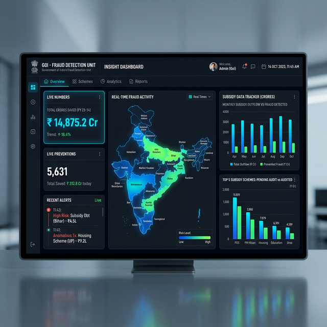

# Product Requirements Document (PRD): SubsiGuard

## 1. Project Overview

### 1.1 What is SubsiGuard?
**Product Name:** SubsiGuard  
**Project Type:** A web-based software dashboard.  
**Main Goal:** SubsiGuard is a smart computer program designed to help the Indian government find out if people are cheating on subsidy programs. A "subsidy" is when the government gives money or cheap goods (like food or gas) to people who are poor. SubsiGuard checks programs like PDS (cheap food grains), PM-KISAN (money for farmers), MGNREGA (work for villagers), and LPG (cooking gas).

### 1.2 Our Big Picture Vision
The goal is to stop money from being stolen so that real, hardworking people get the help they actually need. Right now, workers have to read millions of paper forms or spread sheets to find cheaters, which takes too much time. By using this smart system, the government can save thousands of crores of rupees and build back the trust of the citizens.

---

## 2. The Problem We Are Solving

**Why is this software needed?**
Government welfare programs spend massive amounts of money to help poor people. But a lot of this money goes to the wrong places. We call this "leakage." 

Here are the most common ways this money leaks out:
- **Ghost People:** Some people create fake names and ID numbers to get extra money, or they claim money for people who have already passed away.
- **Double Copies:** The exact same person applies for the same welfare program two or three times using different paperwork.
- **Rich People Claiming:** People who earn way too much money to be considered "poor" still apply and take the help meant for those who are actually struggling.

**The Main Issue:**
Because India is so big, there are millions of records. Government workers simply cannot check every single person's file by hand. It is impossible. This means fraudsters can easily hide in the giant lists of information.

---

## 3. Who Will Use This Software?

### 3.1 Top Government Leaders (Primary Users)
- **Who they are:** Officials who run the welfare programs at the state or national level.
- **What they want:** They want to open the dashboard and instantly see the "big picture." They want to see total rupees saved, which cities have the most cheating, and they want to be able to download clean PDF reports to show in their big meetings.

### 3.2 Ground-Level Officers (Secondary Users)
- **Who they are:** The local workers who actually go to villages and towns to check if a person is real.
- **What they want:** They want very specific details. If SubsiGuard flags a person as a "cheater," the officer wants to know exactly *why* they were flagged (for example, "This person makes over ₹3,00,000 a year but is claiming to be poor"). They use our dashboard to know exactly which houses to visit.

---

## 4. Key Features (What the Software Actually Does)

### 4.1 Step 1: Getting Data into the System
- **Easy File Uploads:** A government worker can click on the screen and drag a big CSV file (which looks like a Microsoft Excel sheet) into the system. This file has all the names, ID numbers, and incomes of the people asking for help.
- **Cleaning the Data:** Sometimes, government spreadsheets are messy. They might have a blank space where a name should be, or numbers where letters should be. Before our system even starts checking for fraud, it quickly reads and cleans up the messy file automatically so it doesn't break.
- **What information we need:** The system expects to see the person's Name, a scrambled version of their Aadhaar Card (so we don't leak their real ID), the Program Name (like PM-KISAN), Money Claimed, Declared Income, and their District Location.

### 4.2 Step 2: Finding the Cheaters (The Smart Brain)
This is the most important part of SubsiGuard. We use two different methods together to make sure we don't make mistakes.

**Method A: Setting Strict Rules (Deterministic Rule Engine)**
This acts like a strict security guard. It follows basic government rules perfectly.
- *Checking Income:* If the government says you cannot earn more than ₹2,50,000, and someone's file says they earn ₹3,00,000, the system instantly flags them.
- *Checking Copies:* It scans the millions of rows to find if the same scrambled Aadhaar ID appears twice in the same month. If it does, it flags it.
- *Checking Giant Amounts:* If a farmer is only supposed to get ₹2,000, but their file says they are claiming ₹50,000, the system flags it as impossible.

**Method B: Brainy AI (Probabilistic Machine Learning)**
Sometimes fraudsters use clever, hidden tricks that break no obvious rules. For this, we use Artificial Intelligence (AI) called an "Isolation Forest."
- The AI acts like a detective linking clues together. It might notice that a teenager living in an expensive city is claiming a subsidy meant for old farmers in rural villages.
- The AI looks at thousands of these little, invisible connections. When it finds someone who acts completely different from the normal, honest crowd, it labels them as a "statistic anomaly" (which means totally weird and suspicious).

### 4.3 Step 3: Giving Out A Risk Score
After Method A and Method B finish checking the list, the system gives every single person a final grade from 0 to 100.
- **Low Risk / Safe (Score 0 to 49):** These people look totally honest. The system tells the government to go ahead and pay them quickly.
- **Medium Risk / Maybe (Score 50 to 79):** The system thinks something is a little strange. The system tells the ground-level officers to go knock on this person's door and check their papers before paying them.
- **High Risk / Danger (Score 80 to 100):** The system is extremely confident this is a scammer. The system tells the government to block their payment right away.

### 4.4 The Main Screen (Interactive Dashboard)
When you log into the website, it looks beautiful and very professional.
- **Live Numbers Check:** At the very top, big numbers show exactly how many Crores of Rupees the software has saved today, and how many bad accounts it caught.
- **Heat Map of India:** A big, interactive map of India. Cities that have a lot of scammers will light up in bright red colors.
- **Bento Grid Layout:** The screen is divided into neat, organized squares (like a Japanese Bento Box). Each square has a different colored chart showing different information, so your eyes don't get tired.
- **Graphs:** Simple bar charts and line graphs show which programs (like PM-KISAN vs LPG gas) are getting cheated the most.

### 4.5 Seeing Specific Reports
- **Deep Dive View:** If a leader sees that the city of Jaipur is red on the map, they can click on it. A list pops up showing every single suspicious person in Jaipur, along with the exact reason why the AI flagged them.
- **One-Click PDF Reports:** Officials don't have to take screenshots. They click a single button saying "Generate Audit Report." The software magically creates a clean, fully formatted PDF document with all the graphs and lists of cheaters, ready to give to the boss.

### 4.6 Demo Mode (For Showing Off the Tool)
- **Practice Mode:** Sometimes, officers want to show this software to their bosses, but the government internet goes down. Our software has a secret switch called "Demo Mode." When clicked, the software instantly starts playing with safely-made fake data so you can still show off the beautiful charts and buttons without needing a real server connection.

---

## 5. Behind-the-Scenes Rules (NFRs)
- **Speed Constraints:** Government files can contain hundreds of thousands of names. The software needs to be able to upload those massive files quickly without crashing the user's internet browser. The colorful charts must pop up on the screen within 1 second of loading.
- **Beautiful Design:** Even though it is for the government, it should look and feel as smooth and premium as a top-tier app like Spotify or Apple. It uses a modern framework (Tailwind CSS) to always look perfect on any size computer monitor.
- **Ironclad Privacy (Security):** The system absolutely will never store real Aadhaar card names in a way that hackers can steal. It relies strongly on token passwords (JWT) to lock out bad guys from accessing the website.

---

## 6. What Tech are We Building With?

- **Frontend (The part users click on):**
  - **Framework:** Next.js version 14 or 15. This makes the website lightning fast.
  - **Language:** TypeScript. This is a coding language that stops us from making simple crashing errors.
  - **Looks:** Tailwind CSS and Shadcn UI (for beautiful buttons and charts). 
  - **Graphs & Maps:** Recharts and Leaflet.js.
  
- **Backend (The hidden brain doing the math):**
  - **Framework:** Python using FastAPI. Python is the best language for AI, and FastAPI makes it reply very quickly to the website.
  - **Data Reader:** Pandas. A tool that reads giant Excel sheets instantly.
  - **The AI Engine:** Scikit-Learn. The specific AI brain model we use.
  
- **Database (Where memories are kept):**
  - We use SQLite for when we are testing, and move up to a stronger vault called PostgreSQL when real government users log in.

---

## 7. Future Blueprint (What We Add Next Year)
- **Live Fingerprint/Aadhaar Connection:** Instead of uploading a spreadsheet file, we will plug our system directly into the Indian Government's live Aadhaar servers so we can check fingerprints the very second someone applies.
- **Un-hackable Records (Blockchain):** When we catch a fraudster, we will lock the record in an un-hackable computer network called a "Blockchain" so that corrupt local workers cannot secretly delete the fraudster's name later.
- **Many Local Languages:** The leaders speak English, but village workers speak local tongues. We will translate the entire dashboard to flip instantly between Hindi, Tamil, Bengali, Marathi, and 8 other languages with one click.
